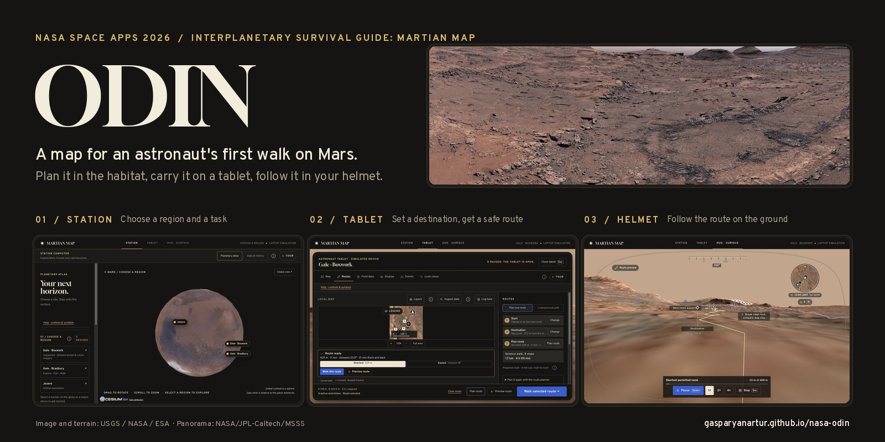

# NASA Space Apps 2026 - Interplanetary Survival Guide: Martian Map

[](https://gasparyanartur.github.io/nasa-odin/)

**Try it in the browser: https://gasparyanartur.github.io/nasa-odin/**


This repository holds one current app. Older versions are kept in `archive/` for reference.

## The current app: `hypersimulation-prototype/`

A map for an astronaut's first walk on Mars. You choose a region and a task at the Station, plan a route on the Tablet, and follow it in the Helmet display. It runs fully in the browser; no server and no Python are needed to run it.

```bash
cd hypersimulation-prototype
npm install
npm run dev
```

Then open http://localhost:5174. Details, data sources and licences: [hypersimulation-prototype/README.md](hypersimulation-prototype/README.md).

Static build (for example for a sub-path host): `VITE_BASE=/nasa-odin/ npx vite build` inside `hypersimulation-prototype/`.

## Live site

The app is live at https://gasparyanartur.github.io/nasa-odin/. GitHub Pages serves it from the branch `gh-pages`, which holds a static build of `hypersimulation-prototype/` (base `/nasa-odin/`). The site does not update by itself: after an app change, build again and push the result to `gh-pages`. The workflow `.github/workflows/pages.yml` can do this on every push to `master` if the Pages source in the repository settings is changed to "GitHub Actions".

## Licence

The code in this repository is licensed under the Apache License 2.0, see [LICENSE](LICENSE). Mars imagery, terrain and measurements come from NASA, USGS, ESA and other agencies and keep their own terms; see `hypersimulation-prototype/public/boxwork/DATA-LICENSE.md` and the source notes in the app README. Parts of the code and documents were written with AI assistance (Claude by Anthropic, OpenAI Codex) and reviewed by the team.

## What is in `archive/`

- `archive/martian-map-v1/`: the earlier Martian Map app that used to be in the repository root, with its own README. The current app grew out of it and contains its features.
- `archive/marswalk-static-data/`: source data, licence and source list of the first static Marswalk prototype.

Nothing in `archive/` is needed to run the current app. See [archive/README.md](archive/README.md).

## Team documents

`docs/` holds the team's documents (backlog, data notes, plans). Some of them still describe the archived app by its old root paths.
