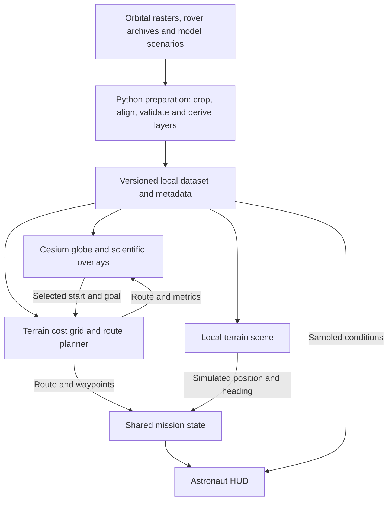

**Martian Map — feasibility of the globe, route planner, and astronaut HUD**

Researched on 3 November 2026. This extends [RESEARCH.md](RESEARCH.md) around the three proposed components. Published capabilities, direct access checks, and proposed engineering choices are distinguished below. This is a research result; no application, planner, terrain conversion, or hardware integration has been implemented or benchmarked.

**Assessment**

All three components are feasible as an integrated software prototype. The main dependency is a small, well-characterized area with aligned elevation and imagery. Terrain supports meaningful route comparisons. Environmental observations and models support historical or hypothetical scenarios, with much less spatial detail.

| Component | Feasible first version | Main technical difficulty |
|---|---|---|
| Interactive 3D globe | Stream Mars terrain/imagery, toggle overlays, inspect values and select locations | Mars coordinate conventions, layer registration, and terrain streaming |
| Route planning | Find a terrain-aware path within a verified local footprint; compare distance, ascent, time estimates and scenario exposure | Turning heterogeneous observations into defensible costs and constraints |
| Astronaut HUD and interactive scene | Move through local terrain; update minimap, waypoint guidance, sampled layers and alerts from simulated position | Keeping scene coordinates, terrain, route and scenario time consistent |

The globe can cover Mars while routing and walking are enabled only inside the prepared area. A small operational area does not require restricting the globe's visual coverage.

**1. Interactive 3D globe**

My first choice is **CesiumJS inside a React/TypeScript application**. It already supplies globe navigation, geospatial rendering, tile streaming, picking and overlay APIs. Its source is Apache 2.0; hosted content has separate access conditions. [CesiumJS](https://cesium.com/platform/cesiumjs/).

A particularly useful existing asset is **Cesium Mars**, a hosted 3D Tiles dataset. The provider lists these approximate resolutions:

| Coverage | Imagery | Terrain |
|---|---:|---:|
| Global | 232 m | 200 m |
| Jezero inset | 6 m | 20 m |
| Gale inset | 25 cm | 1 m |

Access requires a Cesium ion account. The official example sets the Mars ellipsoid, disables the ordinary globe, and loads the tileset as scene geometry. This makes it a promising visual baseline, particularly for Gale. Provider resolutions describe the asset, not uniform measurement accuracy or complete local hazard coverage. [Cesium Mars specifications, example and source links](https://cesium.com/platform/cesium-ion/content/cesium-mars/).

There are two viable rendering approaches:

| Approach | Advantage | Work or uncertainty |
|---|---|---|
| Hosted Cesium Mars 3D Tiles | Avoids building the initial terrain pyramid | Account/content terms; verify overlay registration and simultaneous-layer performance on Mars |
| Cesium globe with custom numeric height tiles and imagery tiles | Direct control of terrain, overlays and hosting | Prepare multiresolution terrain, consistent tile edges, missing-data behavior and vertical conversion |

Cesium supports imagery draping on 3D Tiles through `tileset.imageryLayers`. This was introduced in 1.130 and remains marked experimental in the current API. The first approach can therefore support scientific overlays, but the exact combination needs a small rendering check. If several overlays exceed the target device's texture/performance limits, compose selected rasters into one display overlay or show one scientific raster at a time with independent vector layers. These are proposed fallbacks. [Draping explanation](https://cesium.com/blog/2025/06/30/draping-imagery-over-3d-tiles-in-cesiumjs/), [current API](https://cesium.com/learn/cesiumjs/ref-doc/Cesium3DTileset.html#imageryLayers).

For custom height tiles, `CustomHeightmapTerrainProvider` accepts numeric arrays through a callback and an explicit tiling scheme/ellipsoid. It lacks some facilities of a full terrain provider, including availability and vertex normals; it is suitable for an initial bounded experiment. A production terrain pipeline would need additional work. [Heightmap provider](https://cesium.com/learn/cesiumjs/ref-doc/CustomHeightmapTerrainProvider.html).

Useful initial layers are orbital imagery, elevation, derived slope, geological units, science targets and dataset footprints. Temperature, dust and radiation displays should carry their observation/model time and spatial support. A legend must distinguish a measured value, a derived quantity and a scenario input.

For science overlays, [CRISM derived products](https://ode.rsl.wustl.edu/mars/pagehelp/Content/Missions_Instruments/Mars%20Reconnaissance%20Orbiter%20%28MRO%29/CRISM/Derived.htm) offer targeted spectral information and browse products, while [THEMIS products](https://www.mars.asu.edu/data/) offer thermal context. Choose an interpreted parameter or published geological unit rather than treating browse colors as mineral concentrations. The broader dataset inventory and resolution limits are in RESEARCH.md; shared coverage with the chosen route area remains to be checked.

Mars Trek provides WMTS imagery, and Cesium supplies a WMTS imagery provider. Read the service capabilities rather than constructing tile paths from assumptions. The checked CTX service uses 512-pixel tiles; MOLA uses 256-pixel tiles. Both describe a geographic 2-by-1 level-zero matrix. Configure tile size, matrix labels, extent and planetary reference explicitly. [Trek catalog](https://trek.nasa.gov/tiles/apidoc/trekAPI.html?body=mars), [WMTS provider](https://cesium.com/learn/cesiumjs/ref-doc/WebMapTileServiceImageryProvider.html), [geographic tiling scheme](https://cesium.com/learn/cesiumjs/ref-doc/GeographicTilingScheme.html).

For numeric click inspection, sample the underlying scientific raster. The displayed tile's color is insufficient to recover a calibrated measurement. Likewise, a MOLA shaded-relief image is useful for display but cannot replace an elevation raster.

**2. Route planning between two locations**

The appropriate first method is **least-cost search on a local terrain grid**. This is a 2.5D problem: movement follows a surface with height `z(x,y)`. A volumetric 3D search is unnecessary unless caves, overhangs or other multilevel geometry become part of the scenario.

Proposed processing:

1. Select a bounded area with an actual numeric DTM and matching orthoimage.
2. Inspect product labels, valid-data masks, confidence information and registration.
3. Transform into a Mars-specific local metric frame. Account for projection scale when measuring distance and slope; degrees are not meters.
4. Derive slope, elevation change and roughness proxies at declared baselines. Add documented exclusion polygons and separate manually interpreted hazards.
5. Build directed neighbor transitions: uphill and downhill can have different costs and limits. Prevent diagonal corner-cutting through blocked cells.
6. Run A* between valid endpoints, retaining the selected model/scenario with the result.
7. Sample the final path to report length, ascent/descent, maximum slope at the analysis scale, estimated time, exposure and coverage quality.

GDAL can derive slope from elevation rasters, and Rasterio supports reprojection/resampling. Choose a suitable local projection and inspect its metric scale. Do not copy the Earth-specific degree-to-meter constants in generic GIS examples. Exclude missing-data boundaries from derivative calculations where interpolation would fabricate traversability. Categorical hazards require different resampling from continuous elevation. [GDAL slope](https://gdal.org/en/stable/programs/gdal_raster_slope.html), [Rasterio reprojection](https://rasterio.readthedocs.io/en/stable/topics/reproject.html).

**A route objective should expose its assumptions.** For example, the following is a proposed design, not a validated astronaut model:

`J(P) = wT T(P)/Tref + wE E(P)/Eref + wD D(P)/Dref + wU U(P)/Uref`

Here `T` is estimated travel time, `E` an explicitly defined effort/energy model, `D` scenario-integrated radiation dose, and `U` an uncertainty measure. Reference scales make the terms dimensionless; the nonnegative weights express mission preferences. Unknown terrain with no usable measurements should normally be blocked. Lower-confidence but usable terrain can receive a penalty if the scenario permits it.

Hard exclusions belong outside this weighted tradeoff: a prohibited area must not become traversable because the route saves enough distance. Similarly, a weighted score does not guarantee compliance with a dose, oxygen or time budget. Check resource limits explicitly; resource-constrained search becomes a separate extension if a feasible alternative must be found whenever one exists. A* needs an admissible lower bound to preserve optimality under the selected graph and objective; Dijkstra is a straightforward baseline for checking it.

Useful route modes are “shortest permitted,” “lower effort under this model,” and “lower exposure under this scenario.” Each should report the same underlying metrics. The two selected points may define a one-way route, but an EVA demonstration should also assess a return to a designated habitat or shelter using the remaining budget. Return costs can differ from outbound costs.

| Method | Where it fits | Qualification |
|---|---|---|
| Dijkstra / A* | First fixed-map planner | Start here; validate costs and constraints before adding complexity |
| Theta* / checked path simplification | Reduce grid-direction artifacts | Every shortcut must be checked against terrain, exclusions and integrated costs; arbitrary smoothing can invalidate a route |
| D* Lite | Reuse search work after local map changes | Useful once repeated replanning is actually a bottleneck |
| Time-dependent or time-expanded search | Hazards depend on arrival time; waiting is meaningful | Requires additional state and temporal assumptions |
| Multiobjective/resource-constrained search | Enforce budgets or expose nondominated alternatives | More computation and a more complex user decision |

The authors' [Theta* resources](https://idm-lab.org/project-o-content.html) and the original [D* Lite paper record](https://publications.ri.cmu.edu/d-lite) are good starting points. Replanning a static A* map at intervals is not automatically equivalent to solving a time-dependent planning problem.

**Terrain is the strongest planning input.** HiRISE DTMs commonly have 1–2 m post spacing, while imagery can be much finer. DTM documentation describes seams, faceted areas and other artifacts. A roughness estimate derived from a DTM only describes geometry resolved at the chosen baseline; sand strength, loose rocks, small holes and boot-scale hazards need other evidence. [HiRISE DTM documentation](https://www.uahirise.org/dtm/about.php).

**Climate is feasible as a scenario, with limited local discrimination.** MEDA at Jezero and REMS at Gale provide historical rover-local measurements. These support a dated conditions panel and scenario calibration; they do not measure conditions continuously across every route. MEDA has processed CSV products, which are relatively convenient to ingest. Its Radiation and Dust Sensor concerns UV/optical/IR environmental measurements, not the ionizing radiation measured by Curiosity RAD. [MEDA archive guide](https://pds-atmospheres.nmsu.edu/data_and_services/atmospheres_data/PERSEVERANCE/meda.html), [REMS archive guide](https://pds-atmospheres.nmsu.edu/data_and_services/atmospheres_data/MARS/curiosity/rems.html).

For broader coverage, use downloaded subsets of [NASA Ames reference Mars climate simulations](https://data.nas.nasa.gov/mcmcref/). An alternative is the [Mars Climate Database](https://www-mars.lmd.jussieu.fr/mars/access.html), whose documentation explicitly warns that interpolation of averaged model output misses variability and extremes. Its public web interface is intended for moderate use, and commercial use requires authorization. Neither source supplies a measured street-scale weather field. On a short traverse, all locations may share essentially the same climate cell: departure time, excursion duration and abort rules may be more meaningful than a route detour around a colored “weather patch.”

**Radiation needs a separate model.** Curiosity RAD provides surface observations along its mission, rather than a measured global radiation raster. A basic demo can integrate a declared historical or hypothetical dose-rate scenario over travel time. If that rate is spatially uniform, minimizing integrated dose reduces to minimizing time; the extra layer does not justify arbitrary spatial detours. [RAD data specification](https://pds-ppi.igpp.ucla.edu/data/MSL-M-RAD-3-RDR-V1.0/DOCUMENT/RAD_RDR_SIS.HTM).

Topography can affect radiation: RAD observed reduced exposure near a butte, and a 2026 study models terrain-dependent neutral radiation. However, the relationship depends on particle energies and transport. Optical shadow or slope is insufficient to infer radiation protection. A quantitative shielding layer would require an appropriate transport model or published site-specific results. [NASA discussion of the RAD observations](https://www.nasa.gov/centers-and-facilities/jpl/how-nasas-curiosity-rover-is-making-mars-safer-for-astronauts/), [Charpentier et al., 2026](https://doi.org/10.1029/2025JE009336).

For the first demonstration, I recommend measured terrain plus one clearly identified environmental scenario. Environmental thresholds should be configurable mission assumptions. Converting ambient conditions into suit thermal limits, energy use or oxygen consumption needs a separate validated model.

Preserve the radiation product's physical quantity and units: absorbed dose and dose equivalent are different quantities. Integrating a rover detector reading does not automatically estimate an astronaut's whole-body exposure through a spacesuit.

**3. Astronaut HUD and interactive 3D scene**

This is feasible as a browser simulation. A local scene supplies simulated position and heading; the HUD samples the same terrain and scenario used by the planner. A first version could contain:

| Display | Input |
|---|---|
| Minimap and position marker | Prepared basemap, selected route and simulated position |
| Heading, next waypoint and distance | Position, view/body heading and route geometry |
| Local slope/elevation and nearby exclusions | Numeric terrain and hazard layers |
| Conditions panel | Dated observation or active climate scenario |
| Exposure and return estimate | Scenario clock, traveled path and declared resource model |
| Alerts | Off-route distance, entering excluded terrain, stale/missing data, scenario event |

Keep view heading and movement heading distinct where relevant. A camera looking toward a waypoint does not mean the astronaut is walking toward it.

Two implementation levels make sense:

- **Minimum integration:** use Cesium's local camera view with an HTML HUD and controlled route playback/manual movement. This reuses the globe renderer. Terrain following and camera behavior still need work; Cesium is not a complete walking controller.
- **More convincing walking scene:** use Three.js, optionally React Three Fiber, with a local terrain mesh generated from the same numeric DTM and textured by its orthoimage. Pointer-lock controls provide mouse-look; height sampling handles simple terrain following. Add Rapier only when collision and a character controller are needed. [PointerLockControls](https://threejs.org/docs/pages/PointerLockControls.html), [React Three Fiber](https://r3f.docs.pmnd.rs/getting-started/introduction), [Rapier terrain colliders](https://rapier.rs/docs/user_guides/javascript/colliders/).

Use a local origin near the scene to preserve numerical precision. Define an explicit transform between the scene's axes and Mars coordinates. The mesh, collision surface and planner must share elevation scale, footprint and reference metadata. A HUD minimap can be a lightweight Canvas/SVG view of the prepared area; a second live globe is unnecessary.

Orbital data supplies a measured terrain surface and overhead texture, but close ground views can stretch that texture or expose unresolved geometry. Procedural stones and surface materials can improve presentation if marked as illustrative; they must not silently become measured routing hazards. [MARTIAN](https://github.com/nasa-jpl/martian) demonstrates a HiRISE DTM/orthoimage-to-Blender rendering workflow and could help prepare assets. It targets aerial rendering, and its setup and third-party add-on compatibility still need an installation check.

For an actual deployed astronaut, location is a separate subsystem. Mars has no GPS equivalent available to this prototype. NASA's Perseverance global-localization work matches ground observations to orbital imagery, demonstrating that localization is substantial engineering. A future system could combine visual/inertial odometry, map matching and local beacons, with explicit uncertainty and outage handling. In this demo, label position as simulated ground truth. [NASA global-localization report](https://www.nasa.gov/missions/mars-2020-perseverance/perseverance-rover/nasas-perseverance-now-autonomously-pinpoints-its-location-on-mars/).

The HUD has useful operational precedent. A NASA Joint AR pilot compared navigation aids with five astronaut-office participants in a terrestrial field setting and reported improvements in navigation performance and usability. This supports the interface direction, while leaving Mars deployment and hardware validation open. [Joint AR navigation study](https://ntrs.nasa.gov/citations/20250011653). [NASA SUITS](https://www.nasa.gov/learning-resources/spacesuit-user-interface-technologies-for-students/) is another useful source of interface requirements and examples; its requirements belong to that separate program.

**4. Concrete terrain candidates**

The following are catalog facts checked in this pass, not a completed footprint or raster-quality audit:

| Candidate | Available product | Practical consequence |
|---|---|---|
| Gale | [Merged DEM v3](https://astrogeology.usgs.gov/search/map/mars_msl_gale_merged_dem_1m), 1 m output grid, listed download 3.6 GB | Attractive alongside the hosted visual inset and local REMS/RAD history. Includes CTX, HRSC and MOLA fill where HiRISE is missing; audit the chosen area |
| Jezero landing-site area | [HiRISE DTM mosaic](https://astrogeology.usgs.gov/search/map/mars_2020_terrain_relative_navigation_hirise_dtm_mosaic), 1 m grid, listed 1.8 GB; [orthoimage](https://astrogeology.usgs.gov/search/map/mars_2020_terrain_relative_navigation_hirise_orthorectified_image_mosaic), 25 cm grid, listed 6.9 GB | Prepared products have matching catalog extents and support Perseverance/MEDA context. Still inspect nodata, local alignment and vertical metadata |
| Jezero western extension | [MSR HiRISE DTM, orthoimage and confidence mosaics](https://astrogeology.usgs.gov/search/map/mars-sample-return-terrain-relative-navigation-hirise-dtm-mosaic), listed package 5.3 GB | Strong candidate when the western rim is the science focus; confidence information may help define valid routing coverage |

Download labels and small previews first, then crop an area of roughly a few square kilometers. The catalog pages provide individual product links. Do not load the complete multi-gigabyte rasters into the browser. Catalog bounding rectangles do not guarantee usable coverage throughout their interiors.

Gale has the shortest apparent path to a detailed hosted scene. Jezero has a strong combination of prepared local products and Perseverance science context. I would inspect one small candidate area in each, then choose based on real overlap and the intended excursion story. The hosted Jezero inset is coarser than the independent HiRISE products, so it should not determine the planner's resolution.

**5. Shared architecture and suggested stack**

These are engineering recommendations; no end-to-end integration has been tested.

| Responsibility | Suggested tools | Reason |
|---|---|---|
| Web application | React, TypeScript, Vite | One application for map controls, route comparison and HUD |
| Planetary visualization | CesiumJS | Existing planetary math, camera and tile infrastructure |
| Optional walking scene | Three.js / React Three Fiber; Rapier if needed | Local scene control and interaction |
| Spatial preparation | Python, GDAL, Rasterio, NumPy; QGIS for inspection | Numeric terrain processing and visual registration checks |
| Climate arrays | Xarray with NetCDF support | Subset and sample model dimensions; [official I/O guide](https://docs.xarray.dev/en/stable/user-guide/io.html) |
| Planner/API | Python A* over implicit raster neighbors; FastAPI if a server is useful | Keeps numerical layers and route computation together |
| Smaller deployment alternative | Preprocessed arrays and a TypeScript Web Worker | A bounded fixed-area planner can run without a persistent backend |
| Storage | GeoTIFF/COG for numeric sources; display tiles, compact arrays and JSON manifests | Separate analytical values from browser visualization |
| Mission state | Shared TypeScript store; HTTP for route requests | Route, position, time and scenario remain consistent |

A spatial database, live telemetry server, ML service and multi-user synchronization are unnecessary for the first version. Add WebSockets only when a separate simulator or device actually streams state. Unity or Unreal become reasonable alternatives if the team already has engine experience or physical XR becomes central; the browser stack is my default for the current three-component scope.

Each dataset manifest should retain source URL/product ID, mission/instrument, footprint and validity mask, native versus output resolution, acquisition period, units, no-data definition, quality/confidence semantics, horizontal reference, elevation reference, resampling and processing version. Each route should retain the dataset version and mission assumptions used to compute it.

**Planetary reference handling is a shared dependency.** USGS Mars conventions distinguish planetocentric/planetographic latitude and longitude direction. Cesium's `Ellipsoid.MARS` is documented as a mean-radius sphere, while the checked USGS local products specify a 3,396,190 m reference sphere. Do not assume every Mars dataset uses the same geometry. Handle areoid-relative versus ellipsoid-relative elevation explicitly and verify alignment with landmarks. Standard GeoJSON tooling often assumes Earth; if using GeoJSON-shaped planetary coordinates internally, declare that convention and convert before passing through Earth-default readers. [USGS coordinate conventions](https://planetarynames.wr.usgs.gov/Page/MARS/system), [Cesium ellipsoid documentation](https://cesium.com/learn/cesiumjs/ref-doc/Ellipsoid.html).

For physical Sun direction and local solar time, [NAIF SPICE](https://naif.jpl.nasa.gov/naif/index) is the relevant reference. Terrain shadows additionally need the DTM and visibility calculation. Decorative renderer lighting must be kept distinct from an analytical illumination layer.

**Scale estimate, not a benchmark:** a 2 km by 2 km area sampled every 2 m contains approximately one million cells. One Float32 layer uses about 4 MB; five use about 20 MB before masks, search state, textures and runtime overhead. The same area at 5 m has approximately 160,000 cells. An implicit-neighbor grid avoids millions of explicit graph objects. Precompute derivatives and search at a resolution justified by the data; preserve small exclusion areas conservatively when coarsening. Rendering mesh detail and routing-grid spacing can differ without inventing finer measurements.

**6. Existing methods and systems worth studying**

| Resource | What to take from it |
|---|---|
| [NASA Mars Trek](https://trek.nasa.gov/mars/jpl/config/textAbout.html) | Baseline for layer browsing, planetary navigation and 3D views |
| [Minerva / BASALT](https://ntrs.nasa.gov/citations/20170002363) | Integrated science traverse planning, timeline, optimization and execution monitoring in Earth analog campaigns |
| [PEXTANT](https://pextant.readthedocs.io/en/latest/) | Astronaut traverse-planning structure derived from MIT SEXTANT; [installation instructions](https://pextant.readthedocs.io/en/latest/installation.html) target Python 2.7 and report Windows-only testing, so treat as a method reference before attempting reuse |
| [Joint AR navigation](https://ntrs.nasa.gov/citations/20250011653) | Moving maps, navigation cues and evaluation metrics for a HUD |
| [MARTIAN](https://github.com/nasa-jpl/martian) | Existing HiRISE-to-rendering workflow; inspect setup rather than assuming old Blender tutorials still work |
| [Perseverance global localization](https://www.nasa.gov/missions/mars-2020-perseverance/perseverance-rover/nasas-perseverance-now-autonomously-pinpoints-its-location-on-mars/) | The distinction between displaying a position and estimating one from sensors |

The integrated map/planner/HUD concept has substantial precedent. A useful project contribution would be a coherent, inspectable Mars excursion workflow with traceable data and understandable tradeoffs. This research does not establish novelty.

**7. Recommended scope and implementation checks**

Begin with a global globe and one local excursion area. Offer two or three route alternatives, then let the user enter the scene and follow the selected route while the HUD updates. Demonstrate an explicitly simulated environmental event or new exclusion that changes the return decision.

| Check | Evidence needed before proceeding |
|---|---|
| Data fit | Numeric terrain, imagery and at least one useful science/conditions source overlap the chosen area; masks and references are understood |
| Globe fit | Terrain loads, a scientific overlay aligns with known features, picking returns the expected location, and target hardware handles the chosen layers |
| Planner correctness | Barriers and nodata are respected; disconnected targets return no route; directed slopes behave correctly; A* agrees with Dijkstra on small representative maps |
| Scene consistency | Known waypoints coincide in globe and local scene; rendered/collision terrain uses the prepared elevations; HUD samples agree with map inspection |
| Scenario consistency | Time units, historical timestamps and simulation clock are explicit; return feasibility is recomputed after relevant changes |
| Demo reliability | Selected local assets work from permitted local copies; hosted services have a clear failure state; access/content terms have been checked |

This sequence addresses the main uncertainty before investing heavily in visual polish. A detailed global hazard planner, new climate simulation, quantitative radiation transport, physiological suit model and real-world localization would each be substantial additions. They should follow the first integrated demonstration.

**Direct checks and remaining uncertainty**

On 3 November 2026, fresh HTTPS requests returned HTTP 200 for CTX and MOLA WMTS capabilities, a CTX level-zero PNG tile, Cesium Mars documentation, and the USGS Gale/Jezero catalog pages. The two capabilities documents and CTX tile returned `Access-Control-Allow-Origin: *`. The WMTS documents declare `EPSG:104905`. Original responses and the check summary are stored in [tmp/feasibility-2026-11-03/access_checks.json](tmp/feasibility-2026-11-03/access_checks.json).

The web reader returned 403 for some USGS pages, but ordinary HTTPS requests from this workspace retrieved the catalog text successfully. Additional Jezero product pages were read and saved under the same local directory. These checks establish endpoint and metadata access; they do not establish usable full-raster coverage, browser rendering performance, hosted-account entitlement or routing quality. Full scientific rasters were not downloaded, and no software packages were installed.
