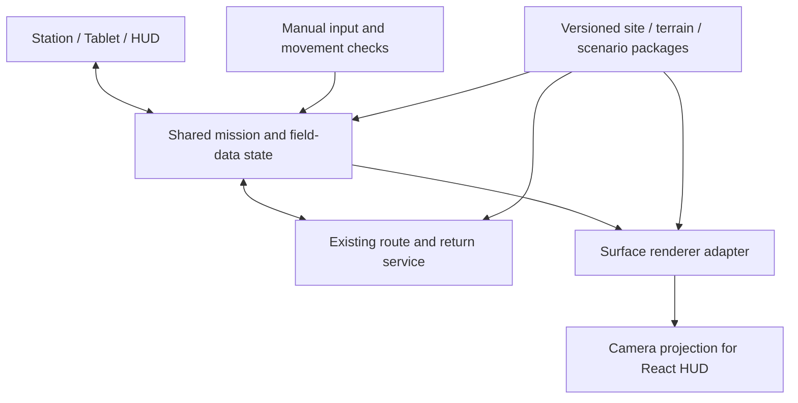

# Integrate the Fable simulator into Martian Map

Date: 2026-11-14. Status: Draft — planning only. Implementation owner: Fable.

## Goal and success criteria

Bring the detailed terrain, imagery and rendering from `hypersimulation-prototype` into the existing Martian Map application. Keep Martian Map's Station, Tablet and HUD organization, shared mission, scientific inspection, route comparison and field-data workflows. The result should feel like the current application with a substantially better surface simulator.

The user has confirmed this product direction and requested a plan only. The architecture and sequencing below are recommendations for Fable's migration; no migration is started by this document.

Success means:

- One application takes users from the Station atlas to a site's Tablet, through route comparison into the detailed surface view, then back to the Tablet without losing the mission.
- The Boxwork terrain and colour imagery render at their supplied detail. The existing Bradbury/Yellowknife example and Jezero atlas remain available.
- Manual walking, restrictions, return estimates, projected navigation, field logging, clocks and HUD configuration work with the new renderer.
- Map picks, scene positions, annotations, route geometry and geographic coordinates agree within documented numerical tolerances. Display quality never changes traversability.
- Existing observations, forecasts and saved field records retain their identity, location, time, source and limitations. The new site does not inherit unrelated observations or targets.
- The integrated result passes the existing relevant tests and new integration checks, has visual evidence using real data, and builds through the current production pipeline. Publication is a separate milestone under FR-015.

## Scope and relationship to the backlog

This is FR-026. It preserves the completed 0.2–0.6 capabilities in the [backlog](../backlog.md), particularly FR-011/014/016–019 and the environmental release. It provides selectable terrain-package groundwork for FR-021, without implementing regional corridors or cross-patch walking. The newer small-screen UX, design and helmet-presentation requests (FR-023–025) remain separate work; preserving the current system means preserving its capabilities and mission continuity, not freezing its layout forever.

| Work | Treatment in this migration |
| --- | --- |
| Station atlas and history; Tablet map, planning, field data and HUD setup; translucent HUD | Retain the current functional organization and visual system. |
| Detailed Boxwork scene, tiled colour/grey imagery, staged loading and terrain rendering | Integrate into the existing application as reusable data/rendering capabilities. |
| Manual surface exploration and current route/return calculations | Preserve and adapt to the new site and renderer. |
| Prototype rover path, approximate drill markers and Sol 4600 conditions | Integrate as inspectable, site-scoped evidence after validating the package. |
| Prototype automated tour, eight-station itinerary, hazard story, rover comparison and printable route card | Preserve the donor source as reference. Optional follow-up work after the core migration; these must not become prerequisites for entering the HUD. |
| FR-013 restriction before/after comparison | Preserve current restriction enforcement/replanning. The full comparison workflow remains requested. |
| FR-020 chemistry/moisture overlays; FR-021 larger-area routing; FR-022 audio notes | Remain separate requests. Add clean extension points, without implementing or marking them complete. |
| Rover-photo NeRF/3DGS reconstruction | Separate investigation; see [local research](../research/2026-11-14-rover-reconstruction.md). The donor is an orbital DEM/orthoimage scene. |
| Public deployment and submission | Retain the current hosting approach and prepare a deployable build. Actual publication remains FR-015 and the [roadmap](2026-11-13-hackathon-roadmap.md). |

## Current state and consequential differences

The inspected integration baseline is commit `c49170b`, which includes the imported prototype. The working tree also contains newer FR-021/022 backlog additions and rover-reconstruction research; preserve those. Code and bundled metadata were inspected for this plan. Test counts and performance figures in earlier release documents and the donor quality gate are prior evidence, not checks rerun during planning.

| Area | Current Martian Map | Fable prototype | Integration implication |
| --- | --- | --- | --- |
| Application | React/TypeScript/Vite; Cesium atlas; Station/Tablet/HUD; state in `App.tsx` | Standalone JavaScript app with a five-step story and its own store/controller | Keep the current application shell. Extract capabilities from the donor rather than mounting a second application. |
| Site | Bradbury terrain centred near Curiosity's landing area; 2 × 2 km, 401 × 401 terrain posts at 5 m | Mount Sharp Boxwork centred at 137.3829997° E, −4.8029979°; 1,024 m projected core, 1,025 × 1,025 height samples; 2,048 m surround at 4 m posts | These are different locations. Add a distinct `gale-boxwork` site; never relabel the existing dataset or transplant its local coordinates. |
| Surface | React Three Fiber scene; one prepared `ortho.jpg`, tinted material, fixed sky/fog | Native Three.js scene; four 2,048 px core tiles at 0.25 m/pixel, colour/grey modes, chunked terrain and surround, hillshade/overlays | Reuse the donor's surface implementation while retaining current interaction and HUD behavior. Post spacing is not an accuracy claim. |
| Coordinates | Local east/north ground metres, geographic conversion using cosine of origin latitude; world `[east, elevation − reference, −north]` | Local projected metres; explicit east-west ground scale; encoded height samples on corners, slope values in cells | A named transform is required at the boundary. Matching variable names are insufficient. |
| Planning | FastAPI/Python; shortest/gentler alternatives, directed return, per-edge profiles and excursion/departure evaluation | Worker-based ordered multi-station tour with polygon no-go areas, a slope objective and rover-range limit | Keep the current planning service and result semantics. The worker is not a drop-in replacement. |
| Walking | Manual WASD/mouse, swept movement checks, slope-dependent speed, live return refresh | Automated route replay with station dwell, its own clock and hazard-triggered return | Retain manual walking as the default. A replay, if later added, must be an explicit mode sharing the mission. |
| Environment | Sol 10 mission anchor; separate Sols 10–28 analysis and Sol 29 outlook; RAD detector E | Sol 4600 REMS air/ground temperature, pressure and UV; RAD detector B with E also recorded | Make scenario epoch and instrument identity site-specific. Do not merge series by field name or silently substitute detectors. |
| User data | Saved Mars GeoJSON v1 field layer, currently hardcoded to Bradbury | Team-input editor with its own browser storage | Extend the current field layer. Do not replace it with the donor editor or overwrite stored observations. |

Implementation references: [application shell](../../src/App.tsx), [terrain and mission contract](../../src/mission/data.ts), [current surface](../../src/mission/WalkingScene.tsx), [site catalog](../../src/datasets/catalog.ts), [field model](../../src/field/model.ts), [route API](../../server/app.py), [conditions evaluation](../../server/conditions.py), [donor renderer](../../hypersimulation-prototype/app/src/scene3d.js), [donor loader](../../hypersimulation-prototype/app/src/loader.js), [donor scene manifest](../../hypersimulation-prototype/app/public/data/scene.json), and [donor controller](../../hypersimulation-prototype/app/src/controller.js).

The donor's [quality gate](../../hypersimulation-prototype/quality-gate.md) leaves slow-network startup, target-laptop performance and publication unverified. Its [alignment report](../../hypersimulation-prototype/data-checks/alignment.md) documents projection agreement and a height comparison that may share the terrain source; it does not establish independent sub-metre ground accuracy. The bundled `screenshot.png` shows mock data and is not a real-terrain visual acceptance reference.

## Proposed architecture

### 1. Keep one mission owner

Keep Station/Tablet/HUD and their React components. Extract the shared mission operations from `App.tsx` into a small renderer-independent controller/store as needed for the migration. Avoid a broad unrelated application rewrite. That owner retains the selected site/dataset version, endpoints, target, alternatives and selected route, pose, scenario epoch, elapsed seconds, restrictions, layers and HUD configuration.

The surface renderer consumes state and exposes camera/projection and interaction events. It does not choose a route, advance a separate mission clock, modify field records or reset a mission when its canvas mounts. Input handling requests movement through the shared movement logic; accepted position and elapsed time then update the renderer and HUD.

Preserve current lifecycle rules: leaving the HUD pauses movement and mission elapsed time; returning restores position, heading and pitch. Display/layer changes retain the route. Endpoint, scenario and restriction edits invalidate incompatible results under the current rules. Switching sites cancels pending work and starts a separate mission setup, while saved records stay associated with their original site. Responses carry dataset/version and request identity so late results cannot contaminate another site.

### 2. Put the donor surface behind a renderer adapter

Recommended default: wrap the donor's native Three.js renderer in a React-owned surface host. Keep its chunked terrain, tiled textures, true-scale geometry, imagery switching and progressive loading. Extend it to support both terrain packages. This preserves more of the supplied renderer than rebuilding it in React Three Fiber.

The adapter must support retained pose/camera updates, route and field overlays, picking, projection, quality changes, resize, load/error status and disposal. Use the current npm Three.js dependency and compatible controls imports; production must not need the donor HTML import map or a second bundled Three.js runtime. Keep the donor app intact as a comparison reference during migration. No iframe, duplicate app navigation or second mission store is part of the finished integration.

Current `FieldGeometry` and `ProjectedWaypoints` depend on the R3F canvas. Adapt their behavior to the new renderer boundary before replacing `WalkingScene`; React still owns the HUD labels, inspection actions and settings. Preserve marker anchors separately from caption placement. The donor's `project()` also tests terrain occlusion, while current navigation labels describe coordinates without a line-of-sight claim: expose in-frustum projection separately and retain that navigation meaning. Any later occlusion feature needs its own label and checks.

Keep the current 2D Tablet map as the primary planning/inspection surface. Add the donor imagery through its existing map transform and retain pan, zoom, keyboard, touch and full-extent fitting. An optional tilted Tablet preview can follow once this works. Do not replace the Tablet with the donor story, drawer layout or replay controls.

Use the old surface as a temporary fallback during development. Remove or retire that duplicate implementation only after the adapted renderer supports both sites and the required overlays. If the adapter proves unable to preserve interaction or performance, Fable should record the specific blocker and revise the renderer decision before doing a second large rewrite.

### 3. Introduce a site package with explicit spatial contracts

Separate site identity, display detail, analytical terrain and scenario data. Extend the current catalog/terrain contract rather than treating the donor's `scene.json` as a replacement for every manifest. Keep donor source files unchanged and produce a versioned runtime package with source identifiers, hashes, credits and reproducible preparation.

| Contract | Required behavior |
| --- | --- |
| Identity and coverage | Stable site/dataset/version; actual geographic bounds; independent render and planning footprints; capability gates. Boxwork planning/walking initially stays within its validated core. The surround supplies visual context. |
| Coordinates | Canonical mission positions remain local east/north ground metres. Convert donor projected `x/y` through its declared ground scale exactly once. Use the inverse for donor grid/texture lookup. Geographic transforms, grid origins, sample-versus-cell locations and metre units are explicit and shared with Python. |
| Elevation | Preserve absolute source elevations and vertical-reference metadata. Keep the renderer's reference-height subtraction separate. Never interpret a patch-relative height as a planetary ellipsoid height. |
| Terrain sampling | Decode donor little-endian uint16 heights using offset −3897 m, scale 0.01 m and nodata 65535. Its uint8 slope scale is 0.25° with nodata 255. Preserve masks and grid registration. Encoding precision does not establish measurement accuracy. |
| Detail | Retain 1 m core height posts and 0.25 m imagery for Boxwork rendering, with progressive texture detail and the supplied surround. Bradbury retains its actual 5 m terrain/available imagery; do not upsample it and call it equivalent detail. |
| Layers and targets | Site-scoped definitions, units, source/time/coverage and inspection. Existing Rocknest/Yellowknife targets remain at Bradbury. Boxwork's team-chosen stations are proposed destinations, distinct from observed rover positions and approximate drill markers. |
| Analytical terrain | A versioned numeric planning grid, validity mask and slope definition, used consistently by routing and movement. Keep display smoothing, nodata fill and skirts out of these arrays. |

For Boxwork, prepare a bounded analytical grid at approximately 5 ground metres for the first migration, retaining the finer display surface. Use a documented conservative aggregation of native terrain gradients/validity, rather than silently treating the donor's smoothed 5 m-baseline slope layer as the existing maximum-gradient product. Generate the corresponding planning overlays and expose both slope definitions when showing the donor science layer. Keep Bradbury's current analytical package unchanged.

Choose grid alignment and dimensions during data preparation, retain edge masks where the footprint does not divide evenly, and verify that fine display heights agree with the analytical samples. Walking uses the same analytical restrictions/slope policy as planning; camera elevation can sample the finer valid DEM. LOD and drawing resolution never relax blocked areas. Infilled display geometry and the lower-detail surround do not authorize movement.

This supplies the multiple-package boundary needed by FR-021. It does not provide a connected route between Bradbury and Boxwork, an enlarged continuous planning area or global multi-resolution search. Higher detail for Bradbury would require a separately verified crop at Bradbury, not reuse of the Boxwork texture.

### 4. Retain route and movement semantics

Generalize the current Python service to load the requested dataset's metadata, grid and conditions. Remove the hardcoded dataset literal, global data path and fixed coordinate bounds in favor of validated catalog entries and package bounds. Preserve both route objectives, directed return routes, per-edge profiles, duration/dose assumptions, departure comparisons and informative no-route behavior. Preserve the existing API shapes where possible and include dataset/version in every relevant result.

Map picks, goals, field restrictions and planner endpoints must use the same canonical coordinates. Replace hardcoded 5 m snapping and Bradbury extents in UI/field validation with the active package's grid contract. Validate a route before entering the HUD and retain swept movement checks, barrier/corner handling and nodata rejection. The manual walker continues to advance in physical time independently of frame rate; the new camera follows its accepted pose rather than following the donor replay clock.

Keep the current circular restriction type and limits for this release. Do not silently approximate donor polygon no-go areas as circles. If supplied polygons are needed for a selected example, add a separately identified, tested polygon restriction path for both planning and movement before enabling that example. Do not import the donor's 15° slope cap, rover-range, suit-time, partner spacing or speed as universal Mars limits; keep their provenance and only adopt them through explicit scenario settings.

### 5. Preserve science, clocks and personal field data

Keep the [0.6 environmental explorer](2026-11-14-environment-release.md) and its analysis selection independent of the mission. Add Boxwork's Sol 4600 records with the source flags, sample counts and caveats in the [chosen-sol report](../../hypersimulation-prototype/data-checks/chosen-sol.md). Preserve missing humidity and UV lower-bound labeling. Convert Celsius to kelvin only for matching quantities: air temperature and ground brightness temperature remain separate.

Give Boxwork its own scenario anchor and bounded historical bins. Do not wrap a finished sol into repeated measured weather, apply the Sol 29 forecast to Sol 4600, or assign early-mission rover observations to the Boxwork site. An explicit action may adopt a compatible snapshot as fixed assumptions, with the existing invalidation notice. The simplest initial Boxwork radiation treatment is the explicitly chosen, spatially uniform detector-rate proxy, with its detector/product shown; keep any hourly analysis distinct from that fixed mission assumption. Never mix absorbed detector dose with astronaut dose equivalent or career limits. The donor's near-Earth SEP event remains a labeled scenario if later used.

Mars LMST uses the active site's scenario sol and elapsed time. Live Earth UTC remains the actual current clock. Neither clock visibility nor renderer changes alter the epoch or mission time. Historical observation/forecast selection remains a third, separately identified analysis time.

Version the field-data schema/storage to carry site, dataset/reference identity and time context. Existing v1 records migrate losslessly as Bradbury records; v1 export/import remains readable. Define a new version for multi-site exports, transform geometry using the declared reference, and reject unknown/incompatible references visibly. Preserve IDs, source, timestamps, uncertainty, visibility, restriction semantics, undo and backup/export recovery. A field-layer ID collision across sites must not overwrite an unrelated record.

Back up the old stored payload before migration and commit the new storage only after validation. On failure, retain the original data and offer recovery/export. Do not reinterpret old local coordinates at the new origin. Extend field drawing, notes, point readings and restrictions to Boxwork through the same Tablet/HUD loop; readings remain point evidence, and visibility remains independent of restriction enforcement. Donor team-input storage is not a replacement for this layer.

### 6. Keep deployment and performance within the current system

Prepare selected donor assets under the existing app's public dataset layout and serve them from the same origin. Reuse the staged overview → surround → core terrain → texture detail approach with visible progress, retry and cancellation. Late imagery/data responses must be ignored after site or imagery changes. Dispose textures, geometry, listeners and render loops when no longer used; suspend unused rendering while another context is active.

Retain Low/Medium/High controls. Additional texture/mesh LOD may change visual detail, but not authoritative sampling or collision. If WebGL fails or is too slow, preserve the mission and provide the existing 2D Tablet map with an honest explanation that 3D/manual HUD walking is unavailable. Do not present a 2D replay as manual surface exploration.

Keep Vite, the Python API, Cesium worker assets and the Docker same-origin deployment. Import only runtime assets needed by the integrated app; do not ship donor design pages, mock data or research tools as runtime dependencies. Carry source citations, file-level data notices, code license attribution and credits from the donor. Preserve the supplied data-license notices; resolving any change to those terms is outside this engineering plan.

## Phases and milestones

All milestones are **Not started**. Fable should update status and evidence in this document during migration. Phases are ordered; optional donor story features do not block the core integration.

| Phase | Deliverable | Dependencies | Completion evidence |
| --- | --- | --- | --- |
| 0. Establish the baseline | Inventory both packages, current local changes, persisted field format, donor assets/licenses and representative real-data viewpoints. Confirm the renderer adapter choice and the analytical grid policy. | This plan and current checkout. | Fresh baseline test/build results; saved Station/Tablet/HUD screenshots and real Boxwork viewpoints; file/hash inventory; recorded tolerances and target-device measurements. Prior quality-gate claims remain labeled as prior evidence. |
| 1. Shared package and coordinate boundary | Bradbury and Boxwork packages load through a common catalog, transform and sampling boundary; mission epoch and field references are site-aware. | Phase 0. | Round-trip geographic/local/projected checks at corners and landmarks; north/UV orientation checks; byte lengths, decode extrema and masks; preserved legacy package behavior; lossless v1 field migration/export round-trip and failed-migration recovery. |
| 2. Surface adapter and visual integration | Donor terrain/imagery renders inside the current HUD shell, driven by retained mission pose; both sites supported. Tablet uses the same imagery/coverage. | Phase 1. | Real-data screenshots at matching coordinates, true vertical scale, core/surround joins and both imagery modes; manual camera/input and quality controls; projected labels, route/field overlays; resize, disposal, load failure/retry and context-loss behavior. The prototype story/store is not mounted. |
| 3. Complete the mission loop | Boxwork planning, route explanations, manual walking, directed return, field edits and site-specific conditions work through the existing views. | Phases 1–2 and the prepared analytical grid. | Station → Boxwork → Tablet → compare → HUD → log here → Tablet → resume; same flow at Bradbury; consistent slope/restriction blocking, return refresh and clock/epoch handling. A restriction edit clears stale routes while retaining position/time. |
| 4. Validate parity and operational limits | Functional, numerical, persistence, visual and performance acceptance completed for both sites. | Phase 3. | Relevant frontend/API suites and complete existing browser suite; new Boxwork/site-switch and data-migration cases; desktop/tablet/phone screenshots; target-device frame times and startup measurement; memory/resource lifecycle checks; documented limitations and remaining failures. |
| 5. Finish the Fable handoff | One production build and documented integrated workflow; current docs/credits updated; temporary migration paths retired after parity. | Phase 4. | Production build/container smoke with datasets, API, health, Cesium workers and missing-asset/API behavior; real integrated walkthrough; review-feature completion review; plan/backlog updated only to the evidenced scope. Public URL validation remains FR-015. |

## Acceptance checks that must survive the migration

Use the current [context](../../tests/contexts.spec.ts), [Tablet map](../../tests/tablet-map.spec.ts), [science](../../tests/science.spec.ts), [field-data](../../tests/field-data.spec.ts), [environment](../../tests/environment.spec.ts) and [mission](../../tests/mission.spec.ts) tests as the behavioral baseline. Adapt selectors for deliberate UI changes without weakening their assertions. Carry over relevant donor geometry, terrain-decoding, imagery-loading and fallback tests into the maintained test workflow; donor tests alone do not establish integrated correctness.

| Area | Required check |
| --- | --- |
| Coordinate agreement | Round-trip error below 1 cm for mathematical transforms at representative points; this is software precision, not source accuracy. Map/scene/route/field anchors agree within their published grid/registration tolerance; no mirrored north or half-cell displacement. |
| Terrain and routing | Invalid/boundary cells blocked; no diagonal corner cutting or barrier tunneling; directed ascent/descent behavior; A* agrees with Dijkstra on small fixtures. A returned route can be followed under the same analytical movement policy. Display nodata fill never creates a path. |
| View and input parity | Repeated Station/Tablet/HUD switching retains route, pose/pitch, time and settings; leaving HUD pauses; pointer lock/blur behave; desktop map controls, keyboard and touch retain full map extent and accurate picking. |
| Field records | Legacy records stay at Bradbury across reload/export/import; new Boxwork records remain at Boxwork; undo/hide/delete/restriction edits work; failed storage/migration preserves recoverable original data. |
| Scientific semantics | Correct site/sol/instrument/unit; air/ground temperature separate; missing bins remain unknown; no implicit scenario adoption; analysis forecasts do not appear as Boxwork predictions. |
| HUD | Current translucent presentation, selectable waypoints, minimap, both clocks, field inspection and log-here survive; labels follow the actual camera and remain legible at desktop/tablet/phone sizes. |
| Async and recovery | Rapid site/layer switches, late route/return replies, failed core/tile loads, retry and WebGL context loss preserve valid mission data and never enable walking before analytical terrain is ready. |
| Performance and build | Record first usable view, full-detail load, frame-time/FPS and peak memory on named hardware/browser at a fixed real route/viewpoint. Adopt the donor's 3-second/10-Mbit first-view and 30-FPS laptop targets as provisional targets to measure, not established performance. Failure to meet them stays visible. |

Run the current repository build/frontend/API/browser commands and the selected donor checks during implementation. Use repository-local `tmp/` for scratch files. Save durable visual/numeric acceptance evidence under `docs/evidence/` and link it from the completion review. No runtime or browser acceptance was executed for this planning document.

## Risks and open decisions

| Risk or choice | Recommended resolution |
| --- | --- |
| Native renderer versus R3F port | Start with the native adapter to retain the supplied rendering. Confirm overlay/input parity in Phase 2 before retiring the old surface; reconsider only against a concrete blocker. |
| Which site opens by default? | Retain the current Yellowknife URL/default flow for compatibility. Add a clearly named Boxwork entry; promote it to the main demo only after its full workflow passes. |
| Fine display geometry versus analytical grid | Use separate documented detail levels, conservative validity/slope preparation and shared routing/movement policy. Record final grid spacing/origin and tolerances in Phase 1. Do not claim metre-scale obstacle detection from the imagery. |
| Datum and source accuracy | Retain donor metadata and its alignment caveats; verify processing/registration. If vertical references cannot be reconciled, keep site-relative rendering explicit and block cross-site geometric operations. |
| Site generalization reaches existing hardcoded assumptions | Include catalogs, globe footprints, overlays, map snapping, API validation, conditions, targets, field schema and clocks in Phase 1/3 review. These are required integration boundaries, not optional cleanup. |
| Bigger download and two WebGL systems | Lazy-load surface code/data, pause inactive scenes and measure resource use with Cesium present. Do not transfer the donor's standalone performance claims to the integrated app. |
| Donor tour/limits broaden the product | Keep itinerary, partner/suit telemetry and hazard replay optional. Team-chosen stations and the unsigned donor science goal remain proposals; sample handling/scoring/debrief workflows remain outside current scope. |
| Missing repeatable data preparation | Donor scripts refer to another machine's raw-data paths. Document configurable inputs, bundled hashes and exact processing; never make those paths or fresh multi-gigabyte downloads runtime requirements. |

## Next milestone and Fable handoff

Fable should start with Phase 0, then deliver the common package/coordinate boundary and an embedded real Boxwork surface as the first reviewable slice. Keep the existing application runnable throughout. That slice must demonstrate correct location, orientation, retained pose, source labels and loading behavior inside the existing HUD shell before broad mission cutover.

The handoff consists of this plan, the current [backlog](../backlog.md), the [Station/Tablet/HUD contract](2026-11-14-station-tablet-hud.md), [field-data behavior](../field-data.md), [environmental model limits](../environment-data.md), and the donor's [app documentation](../../hypersimulation-prototype/app/README.md), [data cuts](../../hypersimulation-prototype/data-checks/cuts.md) and [alignment evidence](../../hypersimulation-prototype/data-checks/alignment.md). The donor's original build plan describes its own standalone product; this integration plan governs the proposed migration into Martian Map.
